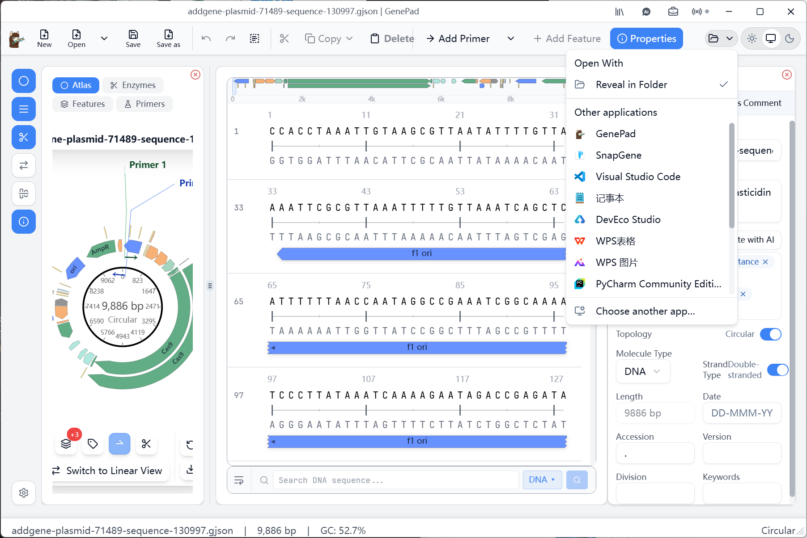
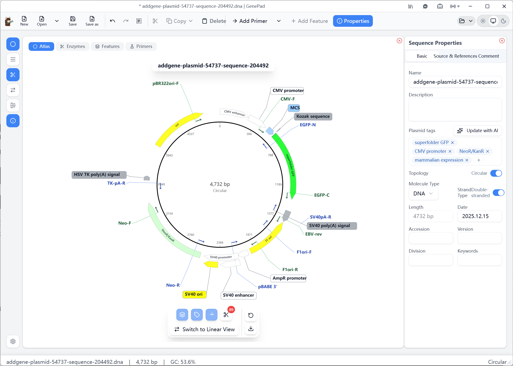
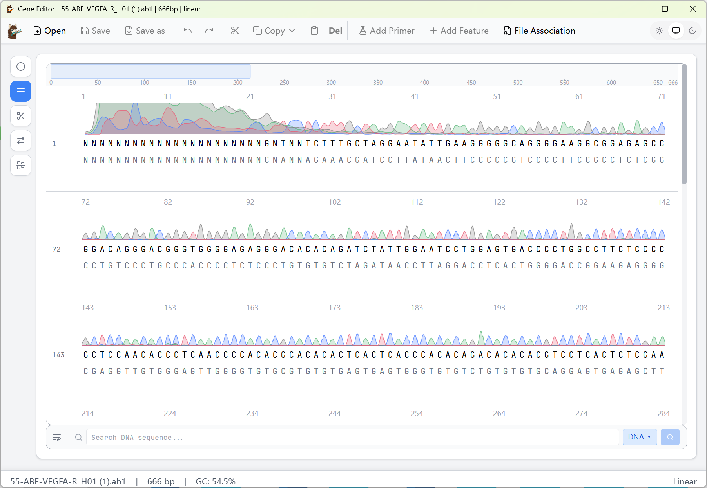
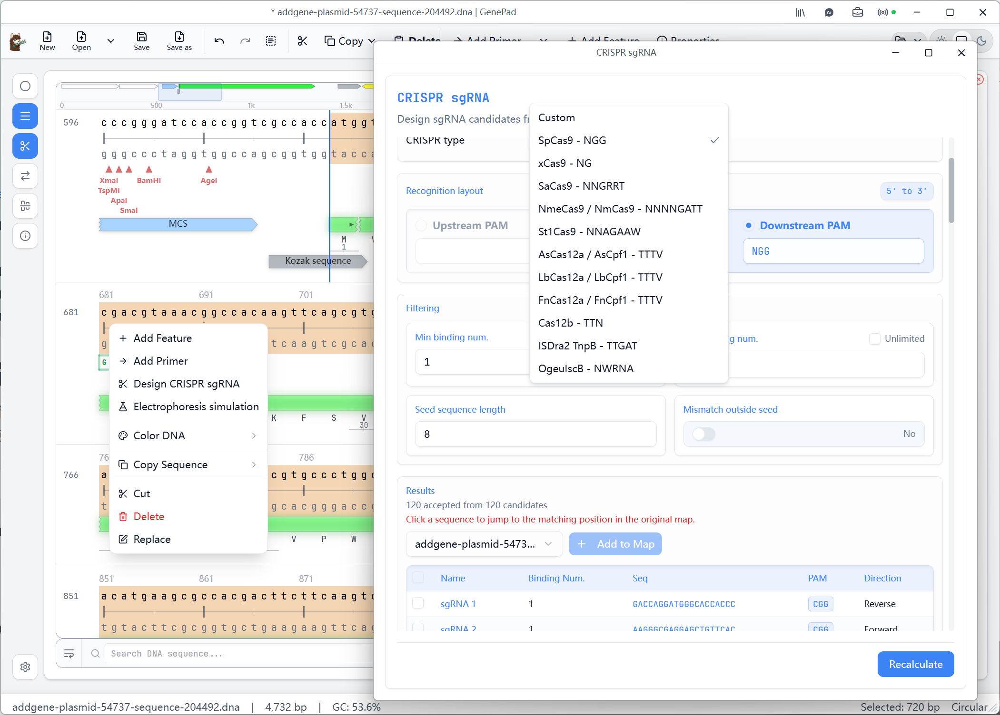
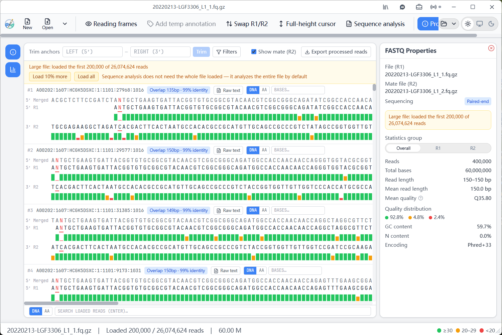
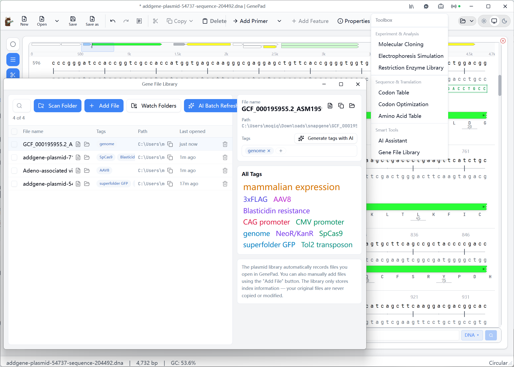
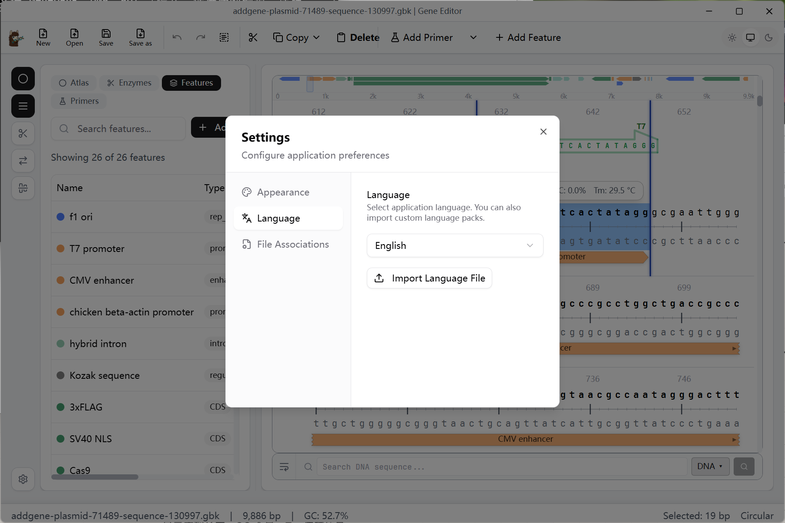

# SnapGene 替代方案：免费的跨平台质粒图谱软件 GenePad

> 备选标题（按搜索意图排列，供挑选）：
> 1. 《SnapGene 替代：免费的跨平台质粒图谱软件 GenePad（附 Windows/macOS/Linux/Android 下载）》
> 2. 《SnapGene 太贵或没有 Linux 版？试试这款免费的 SnapGene 替代软件》
> 3. 《免费质粒绘图软件推荐：SnapGene 的替代品 GenePad 实测》

做分子克隆的人，几乎人手一份 SnapGene：画质粒图谱、查酶切位点、设计引物，确实顺手。但它在两件事上一直让人犹豫——**价格不低**（学术授权也要按席位付费），而且**没有官方 Linux 版**，更别提在手机上查看质粒了。于是"SnapGene 替代""SnapGene 免费版"一直是实验室里的高频搜索词。与其去搜来路不明的破解版，不如看看 GenePad——一款目前免费的替代选择。

本文就来介绍这款轻量、覆盖 Windows / macOS / Linux / Android 全平台的质粒图谱编辑器（当前处于免费公测阶段），看看它能否在你的日常工作流里顶上 SnapGene 的位置。

## 先说结论：既有的 .dna 文件可以直接用

换软件最大的顾虑是文件。GenePad 对此给了一个很实在的答案：**它直接读写 SnapGene 的 `.dna` 格式**。你现有的 `.dna` 质粒文件拖进去就能打开，主序列、拓扑、features、引物、notes 都能正常读出；编辑后也还能存回 `.dna`——需要把文件传回给仍用 SnapGene 的导师或同事时，不会有格式障碍。

程序也保留了「使用其它程序打开」的快捷入口：右键即可把当前文件一键交给 SnapGene（看图谱）、VS Code（看序列）或任何你指定的工具，也可以直接打开文件所在目录。习惯的软件接着用，GenePad 负责补位，两者并不冲突。

换软件不等于推倒重来，这一点对观望者来说可能是最重要的信息。

## 日常克隆工作流：该有的都有

GenePad 的主界面和同类软件的使用习惯一致：图谱、序列、酶切位点、引物信息在同一窗口呈现，打开就能上手。按日常使用频率排下来：

**图谱与序列编辑。** 图谱支持环形与线性视图一键切换，启动子、CDS、复制起点等元件按类别分层着色，标签自动避让，元件众多的载体依然清晰可读；图谱与序列双向联动，在标注表中选定条目，序列视图即定位到对应碱基区间，并同步显示选区长度、GC 含量与 Tm 值。酶切位点直接标注在双链序列上，悬停即可查看识别序列、链方向与上下切口位置，5′ 突出末端明确标示，核验克隆方案很快。序列的选择、插入、替换、反向互补查找、feature 标注增删改、引物添加，都是标配。

**Sanger 测序比对。** 直接导入 AB1 峰图文件，色谱、reads 与参考序列按碱基逐一对齐，结果给出比对一致率与 E-value，错配位点红色标示，送样回来后逐个反应判断质量。

**通用元件自动识别与 ORF 预测。** 打开图谱即自动标出常见元件（启动子、抗性基因、复制子等）。背后的通用元件库覆盖 20 个大类，每条元件都记录 NCBI 登录号与参考质粒名，来源可逐条回溯。另有 ORF 预测、密码子优化等辅助功能。

**CRISPR sgRNA 设计。** 支持 SpCas9、xCas9、Cas12a/b、TnpB 等 12 种识别布局，PAM 方向、种子区长度、脱靶过滤均可配置，候选序列可一键标注回图谱。

**电泳模拟与蛋白属性。** DNA 电泳可选中一段序列从右键菜单模拟琼脂糖凝胶条带位置，内置 Trans2K® 等主流分子量标准；SDS-PAGE 蛋白电泳可选中 CDS 或氨基酸区段上样，以预染 Marker 为参照实时计算条带位置。选中 CDS 还能实时算出分子量、等电点、GRAVY、脂肪族指数与消光系数，等电点内置 19 种算法供对照。

**明暗双主题。** 同一界面提供完整的明亮与深色两套配色，白天投影演示、晚上赶工看图谱，各得其所。

这些覆盖了日常做克隆最常用的那一部分。需要说明的是，工具箱中的**分子克隆（Molecular Cloning）**已上线部分功能，Gibson、Golden Gate 这类完整的克隆流程模拟仍在开发完善中——如果你的工作完全建立在克隆模拟之上，目前还需要保留原工具；这也是唯一需要提前讲清楚的短板。

## SnapGene 没有的几件事

作为替代品，光追平不够，GenePad 有几处差异化的能力：

**NGS 数据查看。** 这在同类桌面软件里相当少见：GenePad 能直接打开 fastq.gz / fastq / fq.gz / fq 文件（gzip 无需解压），双端测序 R1/R2 自动配对并逐条拼接，每个碱基按 Phred 质量着色，还支持按氨基酸片段检索定位多变区、设置锚点批量裁切，并一键生成文库丰度报告（可导出 CSV）。做噬菌体展示、定向进化文库的朋友可以直接拿它看各轮筛选的富集情况，不必为"看一眼"搭一套比对流程。

**基因文件库。** 把散落在各个文件夹里的质粒文件统一建索引（只建索引，不动原文件），AI 依据序列与标注自动打性质标签（lentiviral、sgRNA、ampicillin……），支持监视文件夹自动收录；想不起文件名时，按一两个属性特征就能检索定位。

**AI 助手。** 目前专注于两件事：一是帮你整理与检索基因文件库——用一句话描述需求，它替你把文件找出来；二是通用元件知识问答——某个启动子、抗性基因是什么、常用在什么场合，可以直接问它。

**多语言界面。** 这一点 SnapGene 确实比不了：GenePad 内置中、英、日、法、德、俄六种界面语言，还支持导出语言包、通过 AI 辅助翻译接入自定义语言——理论上任何语言都能生成一整套界面。对国内用户来说，原生中文界面本身就是不少人选它的理由。

## 一张表看差别

| 对比项 | SnapGene | GenePad |
| --- | --- | --- |
| 价格 | 收费（学术授权按席位付费） | 免费公测；学术用户 2026–2027 年免费授权 |
| 平台 | Windows / macOS | Windows / macOS / Linux / Android |
| 界面语言 | 仅英文 | 内置中英日法德俄，AI 翻译可接入任意语言 |
| SnapGene `.dna` 文件 | 原生 | 直接读写，与 SnapGene 用户互通 |
| NGS fastq 查看 | 无 | 有（gz 直读、PE 拼接、丰度报告） |
| 基因文件库 / AI 助手 | 无 | 有 |

## 授权怎么说

GenePad 当前处于**免费公测**阶段；公测结束后，图谱查看、编辑、保存等**已有功能依旧永久免费**，不会把现在用着的日常操作变成付费墙里的东西。高校、医院课题组、iGEM 选手、学生等**学术用户在 2026 年至 2027 年 12 月 31 日期间自动获得免费使用权限，无需申请**；后续商业使用将由 GenePad Pro 授权支持。对课题组和学生来说，成本问题可以不用放进考虑范围。

## 下载

- 官网（免费下载）：<https://genepad.cn>
- Windows、macOS、Linux、Android 四端功能一致；已安装用户下载最新版**覆盖安装即可升级**，无需卸载旧版本
- 安装包在 GitHub Releases 与 Gitee 镜像同步提供（国内可走 Gitee 加速）；macOS 支持 `brew install genepad/tap/genepad`，Linux 支持 npm 与一键脚本，国产 Linux 发行版也可通过星火应用商店安装

如果你正在找 SnapGene 的免费替代软件，或者只是想要一款 Linux / 手机上也能打开质粒图谱的工具，GenePad 值得放进工具箱试一试。本文的图文教程版已上架官网教程中心（提供中、英、德、俄、日、韩、法七个语言版本）：<https://genepad.cn/tutorial-snapgene>。
